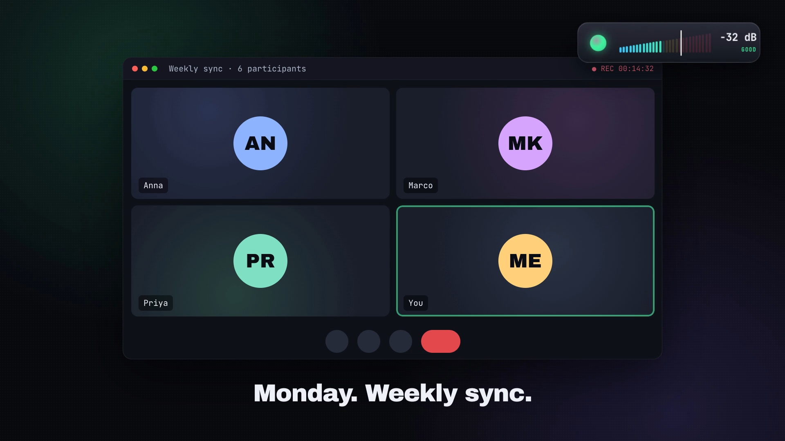
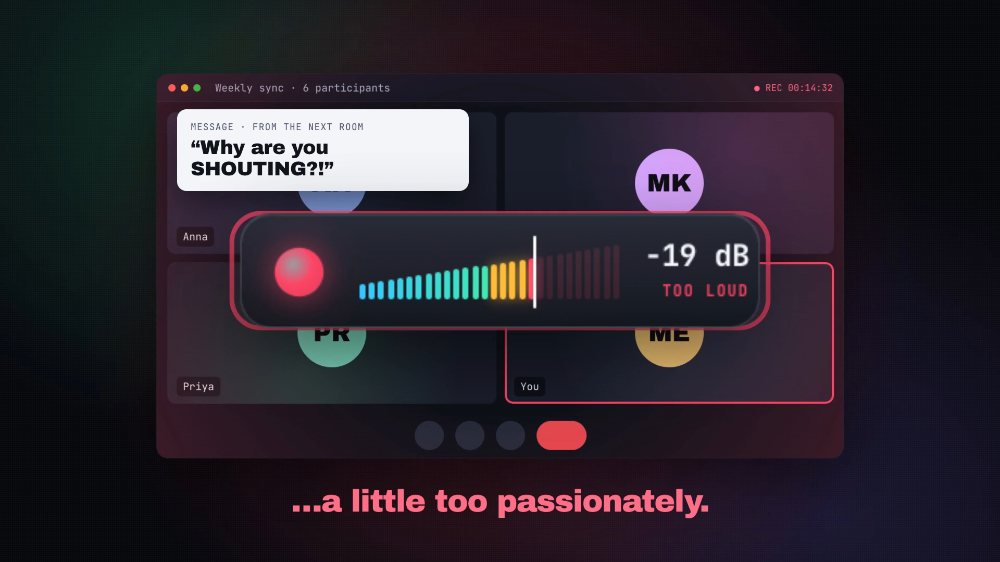
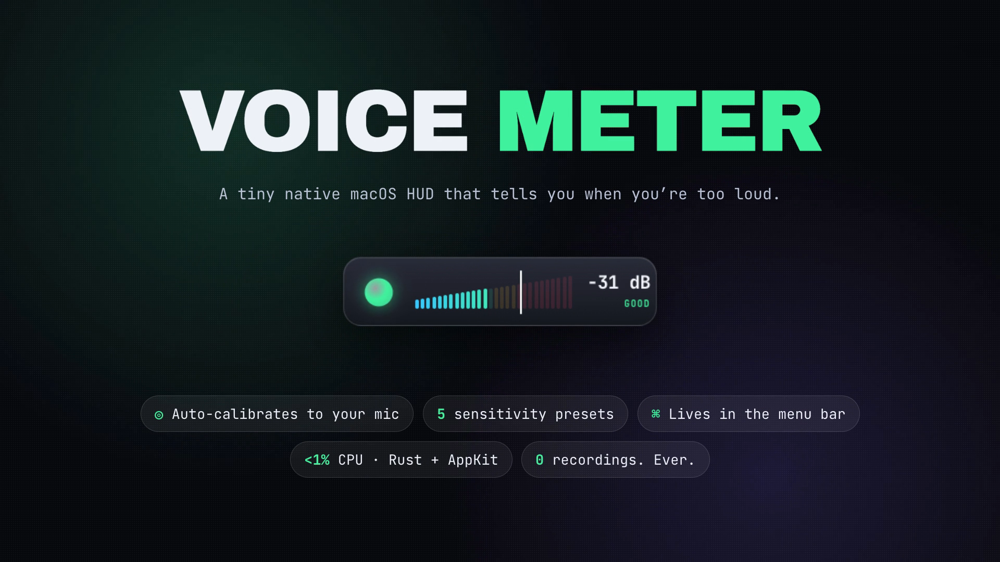
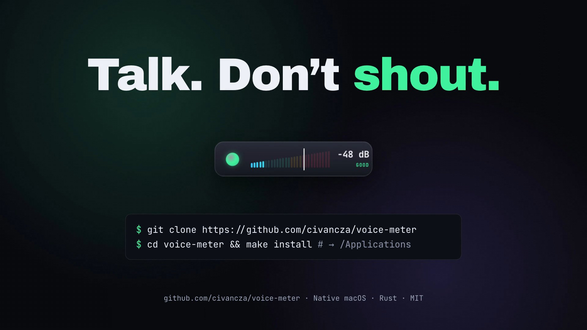
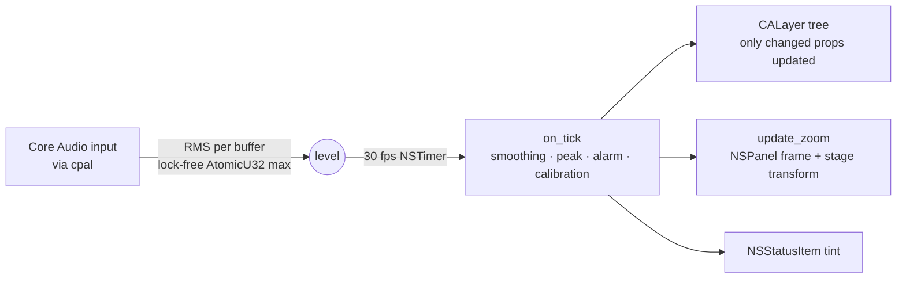

# 🎙️ Voice Meter

**A tiny native macOS app that tells you when you're talking too loudly in meetings.**

<p align="center"></p>
<p align="center"><a href="docs/demo.mp4">▶ Watch the full 30-second demo with sound (MP4)</a></p>

<p align="center">
  
  
</p>
<p align="center">
  
  
</p>

Voice Meter floats a small glass HUD above every window (including full-screen Zoom / Teams / Meet / Slack huddles) and shows your speaking level live. Cross your personal limit and it pulses red, turns the menu-bar icon red, and, if you want, **jumps to the middle of the screen at 2× size** so you can't miss it.

Written in Rust directly against AppKit + Core Animation + Core Audio. No Electron, no webview, no GPU framework.

| | |
|---|---|
| Binary size | ~0.4 MB |
| CPU (idle meeting) | ~0.5–1 % of one core |
| Memory | ~25–45 MB RSS (mostly shared system frameworks) |
| Audio | Level only. Nothing is recorded, stored or sent anywhere |

## Features

- 🟢 **Live meter**: glowing orb, 28-segment wedge meter, peak hold, dB readout.
- 🚦 **Clear states**: `QUIET` → `GOOD` → `EASY…` → `TOO LOUD`.
- 🎯 **Your limit**: the white tick on the meter. Pick from 5 strictness presets or…
- 🎤 **Calibrate**: speak normally for 5 s and the limit is set ~6 dB above your comfortable voice.
- 🔴 **Jump to center**: when too loud, the HUD glides to the screen center at 2.2× size, then returns home (toggle in menu).
- 🖱️ **Drag anywhere**: position is remembered (multi-monitor aware).
- 📌 **Menu-bar icon**: lives in the menu bar, no Dock icon. Right-click the HUD for the same menu.

## Quick start

### Option A: Download a release (no tools needed)

1. Grab `VoiceMeter-<version>-macos-arm64.zip` (Apple Silicon) or `…-x86_64.zip` (Intel) from the [Releases](https://github.com/civancza/voice-meter/releases) page.
2. Unzip and drag **VoiceMeter.app** to `/Applications`.
3. The app is not notarized, so the first time macOS will block it. Either
   - right-click the app → **Open** → **Open**, or
   - run `xattr -dr com.apple.quarantine /Applications/VoiceMeter.app`.
4. Allow **microphone access** when asked.

### Option B: Build from source

Requirements: macOS 11+, [Rust](https://rustup.rs) (stable ≥ 1.87), Xcode Command Line Tools (`xcode-select --install`).

```sh
git clone https://github.com/civancza/voice-meter.git
cd voice-meter
make run          # builds VoiceMeter.app and launches it
# or
make install      # builds and copies it to /Applications
```

No `make`? Use `scripts/bundle.sh` (add `--install` to copy to `/Applications`) and then `open VoiceMeter.app`.

### Start automatically at login

System Settings → General → **Login Items** → `+` → choose **VoiceMeter.app**.

## Usage

| Action | How |
|---|---|
| Show / hide the HUD | Menu-bar `waveform` icon → *Hide/Show Meter* |
| Set how strict it is | Menu → *Very strict … Very relaxed* |
| Calibrate to your voice | Menu → *Calibrate to My Voice*, then talk normally for 5 s |
| Toggle jump-to-center | Menu → *Jump to Center When Too Loud* |
| Move the HUD | Drag it |
| Quit | Menu → *Quit Voice Meter* (⌘Q) |

Levels are dBFS of the default input device (0 dB = clipping). Typical speech sits between −35 and −15 dB depending on mic gain, which is why calibrating once is recommended.

## Troubleshooting

- **Shows `NO MIC` / meter never moves**: System Settings → Privacy & Security → **Microphone** → enable *Voice Meter*. Then quit and relaunch.
- **Re-prompt for microphone permission**: `tccutil reset Microphone com.civancza.voicemeter`.
- **Wrong microphone**: Voice Meter follows the macOS default input (System Settings → Sound → Input). Relaunch after changing it.
- **Reset all settings**: `defaults delete com.civancza.voicemeter`.

## How it works



See [AGENTS.md](AGENTS.md) for a deeper architecture walkthrough.

## Demo video

The demo is code too: an HTML/GSAP composition rendered with [HyperFrames](https://hyperframes.dev), with a
synthesized soundtrack (no stock music). Source lives in [`videos/voice-meter-demo`](videos/voice-meter-demo).

```sh
cd videos/voice-meter-demo   # needs Node 22+ and ffmpeg
scripts/mix.sh               # regenerate the soundtrack
npx hyperframes preview      # live preview in the browser
npx hyperframes render -o renders/voice-meter-demo.mp4
```

## Contributing

PRs welcome! Read [CONTRIBUTING.md](CONTRIBUTING.md). AI coding agents should start with [AGENTS.md](AGENTS.md).

## License

[MIT](LICENSE)
